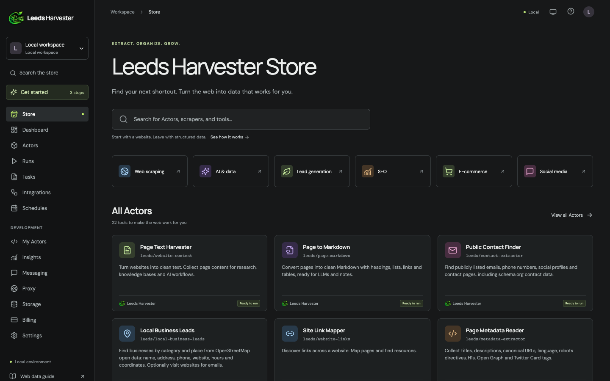
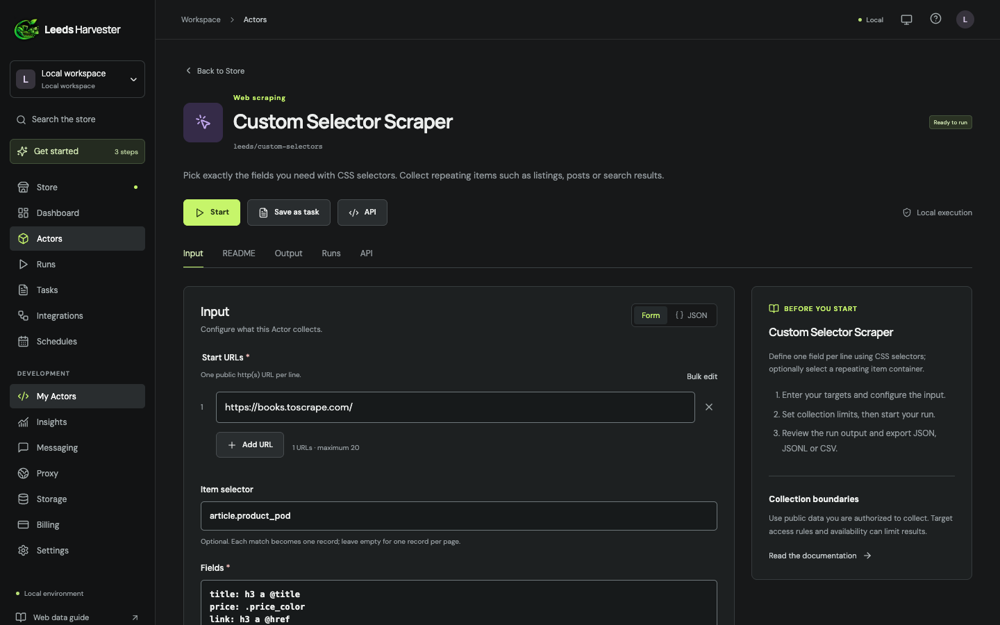

<p align="center">
  
</p>

<h1 align="center">Leeds Harvester</h1>

<p align="center">
  <strong>A self-hosted, open-source web scraping workspace.</strong><br>
  Thirteen scrapers in one local app: page text, Markdown, contacts, local business leads, products, tables, structured data, CSS selectors, RSS/Atom feeds, sitemaps, social posts and AI extraction, with runs, saved tasks, cron schedules and JSON/JSONL/CSV export.
</p>

<p align="center">
  
  
  
  
  <a href="LICENSE"></a>
  <a href="CONTRIBUTING.md"></a>
</p>



## Why Leeds Harvester

- **Open it and work.** No account or sign-in. The homepage leads straight to the Store and the dashboard.
- **Runs on your machine.** A Node.js server and a SQLite file. No cloud service is needed, and only the AI extractor uses an API key (your own).
- **Real extraction, with sources.** Every record keeps its source URL and collection time.
- **A polite crawler by default.** It follows `robots.txt`, waits between requests to the same site (honouring `Crawl-delay` up to 10 s), and retries throttling and temporary errors with backoff.
- **Repeatable.** Save any scraper's input as a task and schedule it with interval or five-field cron timing in any time zone (UTC by default).
- **Export anywhere.** Download any dataset as JSON, JSONL or CSV. CSV cells are protected against spreadsheet formula injection.

## Screenshots

| Homepage                                               | Dashboard                                                               |
| ------------------------------------------------------ | ----------------------------------------------------------------------- |
|  |  |

| A scraper's input form                                              | Run results                                                                    |
| ------------------------------------------------------------------- | ------------------------------------------------------------------------------ |
|  |  |

## Built-in scrapers

| Scraper                     | Collects                                                                                                                                                                                 | Input                                |
| --------------------------- | ---------------------------------------------------------------------------------------------------------------------------------------------------------------------------------------- | ------------------------------------ |
| **Page Text Harvester**     | Clean page text                                                                                                                                                                          | URLs                                 |
| **Page to Markdown**        | Headings, lists, links, tables and code as Markdown, ready for LLMs                                                                                                                      | URLs                                 |
| **Public Contact Finder**   | Emails, phone links, social profiles and contact pages, including schema.org contact data                                                                                                | URLs                                 |
| **Local Business Leads**    | Businesses by type and place: name, address, phone, website, opening hours and coordinates, plus optional email lookup on their websites                                                 | Business type and city               |
| **Site Link Mapper**        | Same-site link maps                                                                                                                                                                      | URLs                                 |
| **Page Metadata Reader**    | Title, description, canonical URL, language, robots, H1, icon, Open Graph and Twitter Card                                                                                               | URLs                                 |
| **Structured Data Reader**  | JSON-LD, microdata, Open Graph and Twitter Card entities                                                                                                                                 | URLs                                 |
| **Product Data Extractor**  | Name, brand, price, currency, availability, rating, SKU/GTIN and images from shop pages that publish product data                                                                        | URLs                                 |
| **Table Extractor**         | HTML tables as rows keyed by their headers                                                                                                                                               | URLs                                 |
| **Custom Selector Scraper** | Any fields you choose with CSS selectors, including repeating items                                                                                                                      | URLs, selectors                      |
| **Feed & Sitemap Reader**   | RSS, Atom and RDF items; sitemap URLs (also `.xml.gz`), following sitemap indexes on the same site. Given a site's home page, it reads the sitemaps declared in that site's `robots.txt` | Feed or sitemap URLs, or a home page |
| **Social Post Reader**      | Public post metadata from YouTube, TikTok, Vimeo, X, Reddit, Spotify, SoundCloud and Dailymotion through their official oEmbed endpoints                                                 | Post URLs                            |
| **AI Data Extractor**       | Whatever you describe in plain language, returned as JSON by your own AI model                                                                                                           | URLs, instruction                    |

Crawl-based scrapers can follow same-site links up to 20 pages per run.

Local Business Leads uses [OpenStreetMap](https://www.openstreetmap.org/copyright) data through the public Nominatim and Overpass services, with one request to each per run. Every record carries the ODbL attribution that the data's license requires.

### Custom selectors

Write one field per line: `name: CSS selector`. Add `@attribute` to read an attribute, and put `[]` after the name to collect every match:

```text
title: h2
price: .price
link: a @href
tags[]: .tag
```

Set an **item selector** (for example `.product-card`) to get one record per repeating item.

### AI extraction

The AI Data Extractor works with any OpenAI-compatible chat completions endpoint: OpenAI, OpenRouter, Groq, Together, or a local server. Set these variables, then restart the server:

```sh
export LEEDS_LLM_BASE_URL=https://api.openai.com/v1   # any OpenAI-compatible base URL
export LEEDS_LLM_MODEL=gpt-4o-mini
export LEEDS_LLM_API_KEY=sk-...                       # omit for local servers without keys
```

Page content (as Markdown, up to 30,000 characters per page) is sent to that endpoint. The model is told to treat the page as untrusted data, and its reply is stored as data only; it never controls the crawler. The API key is read from the environment and is never stored with runs.

## Quick start

Requires Node.js 24.15 or newer (built-in `node:sqlite`). The pinned version is in [`.nvmrc`](.nvmrc).

```sh
git clone https://github.com/KritishX/leeds-harvester-web-scraper.git
cd leeds-harvester-web-scraper
npm ci
npm run dev
```

Open <http://leedsharvester.localhost:4180>. The homepage links to the Store and the dashboard. `localhost:4180` works too.

Production mode serves the built frontend and the API from one process at <http://leedsharvester.localhost:4181>:

```sh
npm test
npm run build
npm start
```

Data is stored in `data/leeds.sqlite`. Set `LEEDS_DATA_DIR` to keep it somewhere else, and `PORT` to change the server port.

### Local address

Browsers send every `*.localhost` name to your own computer, so `leedsharvester.localhost` works with no setup and no domain purchase.

To use another name, such as `leedsharvester.test`:

1. Point it at your computer (this needs an admin password once):
   ```sh
   echo "127.0.0.1 leedsharvester.test" | sudo tee -a /etc/hosts
   ```
2. Allow it, then start the app:
   ```sh
   LEEDS_HOSTS=leedsharvester.test npm run dev
   ```

Prefer `.test` or `.localhost` over a real `.com`. A hosts entry for a `.com` hides the real website of that name on your computer.

## How it works

```text
React 19 + Vite UI  ──/api──▶  Node.js HTTP server  ──▶  SQLite (runs, tasks, schedules)
                                     │
                                     ├──▶  Fetch session: public-URL guard → robots.txt → per-host delay → retries
                                     ├──▶  Extractors: HTML (cheerio), Markdown, JSON-LD/microdata, tables, selectors, XML feeds
                                     └──▶  Sources: OpenStreetMap, oEmbed, your AI endpoint
```

- **One catalog:** `server/catalog.mjs` declares every scraper and its input fields. The server validates input against it, and the UI builds its forms from it.
- **Runs:** at most two run at a time, with a queue of up to 20 pending runs.
  - Each run is limited to 20 pages, 2 MB per page (10 MB per feed or sitemap file), 20 MB of downloads, and 20 MB or 10,000 records of stored results.
  - The deadline is 60 s per run, 120 s for local leads and 180 s for AI extraction.
- **Cancellation and restarts:** cancelled runs keep their partial results. Runs interrupted by a restart are marked as failed instead of being left running.
- **Schedules:** they only fire while the server is running.

See the [API contract](docs/api-contract.md) for every endpoint.

## Security model

Leeds Harvester has no sign-in, so it is designed to run on your own computer only:

- The server listens only on `127.0.0.1`, and it accepts only `localhost`/`127.0.0.1` Host headers, which blocks DNS-rebinding attacks.
- Every request that changes data must come from the app's own origin, so other websites can't make changes through your browser.
- Every outgoing request goes through one guard: public `http(s)` addresses on standard ports only. Private, loopback and reserved addresses are rejected, every DNS answer is checked, the connection uses the checked address, and every redirect is validated again. The only exception is your AI endpoint, which you configure yourself.
- Scraped HTML and XML are parsed as data and never executed. Pattern matching is bounded, so a hostile page or `robots.txt` cannot freeze the server.

There is no sign-in, so **any program or user on the same computer can use the workspace**. Don't expose the port to a network. Before any shared deployment, add authentication, HTTPS and backups. The full model is in [docs/security-model.md](docs/security-model.md), and the checks that were run are in [docs/validation.md](docs/validation.md).

## What it deliberately does not do

Leeds Harvester collects **public** data. It has no features for logging in to sites, using private or mobile APIs, bypassing bot challenges or CAPTCHAs, rotating proxies to evade blocking, extracting group members, or sending messages. [docs/capability-sources.md](docs/capability-sources.md) lists which open-source scrapers were studied, what was built independently from them, and what was declined and why.

## Limitations

- It reads the HTML and XML a server returns and doesn't run JavaScript. Pages that build their content in the browser, sites behind bot challenges, and pages that need a login may return incomplete results.
- IPv6-only websites are not supported. Sitemap files over 10 MB are skipped (for a gzip-compressed `.xml.gz` sitemap, 10 MB after decompression), and one sitemap file yields at most 10,000 URLs.
- Local Business Leads depends on OpenStreetMap's free Overpass service, which is sometimes busy. Runs try a public mirror before reporting the outage.
- Product data depends on shops publishing schema.org or Open Graph product markup. Many large marketplaces don't, or don't allow crawling.
- Integrations are saved preferences only. No webhook or third-party delivery happens.
- There is no billing, cloud execution, proxy pool or hosted publishing.

## Project layout

```text
server/   API, run engine, catalog, fetch session, robots.txt, extractors, sources
src/      React application (single entry: main.tsx) and styles
tests/    node:test suites for the API, run engine, extractors and parsers
docs/     API contract, security model, validation record, capability sources, screenshots
.github/  CI workflow, issue forms and pull request template
```

## Contributing

Leeds Harvester is open source, and contributions are welcome: new scrapers, bug fixes, UI polish and documentation.

1. Read [CONTRIBUTING.md](CONTRIBUTING.md) for setup, the project layout and the rules that keep the crawler safe.
2. Find or open an [issue](https://github.com/KritishX/leeds-harvester-web-scraper/issues) describing the change.
3. Fork the repository, make your change with tests, and open a pull request. CI runs `npm test` and `npm run build`.

Please follow the [Code of Conduct](CODE_OF_CONDUCT.md). Report security vulnerabilities privately as described in [SECURITY.md](SECURITY.md).

## License

[MIT](LICENSE) © 2026 Kritish Dhital. You're free to use, modify and distribute Leeds Harvester, including commercially. Scrape responsibly: collect only public data, and respect each site's terms and applicable law. OpenStreetMap data is © OpenStreetMap contributors and available under the [ODbL](https://opendatacommons.org/licenses/odbl/).

## Credits

Designed and built by **Kritish Dhital**. The Leeds Harvester name and logo are original to this project. Several capabilities were inspired by studying other open-source scrapers; no code was copied. See [docs/capability-sources.md](docs/capability-sources.md).

## Scraper workspace and independent platform collectors

Every scraper has the same **Input, README, Output, Runs and API** screens. Input supports individual URL rows, bulk URL entry and an editable JSON view; the header can start a run or save the current configuration as a task. Each scraper's output fields and limits are documented from this implementation. The dataset view shows every returned field. This is Leeds Harvester's own code and design, informed by the public Apify interface; it does not call Apify Actors or recover their private backend.

Nine additional collectors are included:

| Scraper                       | Independent implementation                                             | Current boundary                                                                        |
| ----------------------------- | ---------------------------------------------------------------------- | --------------------------------------------------------------------------------------- |
| TikTok Scraper                | Known public page hydration and explicit metadata fallback             | Sample public profile returned no supported data; access limited                        |
| Instagram Scraper             | Public JSON-LD and page metadata                                       | Tested post blocked by robots.txt                                                       |
| Instagram Profile Scraper     | Public profile JSON-LD and page metadata                               | Tested profile blocked by robots.txt                                                    |
| Instagram Reel Scraper        | Public video JSON-LD and page metadata                                 | Tested reel blocked by robots.txt; no media downloading                                 |
| Facebook Search Posts         | Public keyword-search page and structured post records                 | Tested search blocked by robots.txt; no people/private-group collection                 |
| TikTok Search Scraper         | Public keyword-search page and embedded search records                 | Tested search blocked by robots.txt                                                     |
| Google Maps Scraper           | Google Places API (New) Text Search, up to 60 results                  | Requires an enabled API key and Google billing; paid requests not tested                |
| Google Search Results Scraper | Google Custom Search JSON API, up to 100 organic results               | Existing eligible API customers only; API closes January 1, 2027; no ads/AI overviews   |
| YouTube Scraper               | oEmbed for known videos; Data API for search and video/channel metrics | URL-only mode verified live; search/metrics require a key; no downloads or quota bypass |

The six public-page collectors are labelled **Public access limited**, not verified live-working. Their parsers and workers pass controlled fixture tests; blocked/empty source pages produce a failed run with the actual reason. No cookies, account login, private endpoints, proxy evasion or CAPTCHA bypass are implemented. See [the REA and validation record](docs/scraper-workspace-validation.md).

Optional independent Google API configuration (environment only; restart the server after setting):

```sh
export LEEDS_GOOGLE_MAPS_API_KEY='your-places-api-key'
export LEEDS_GOOGLE_SEARCH_API_KEY='your-existing-custom-search-api-key'
export LEEDS_GOOGLE_SEARCH_ENGINE_ID='your-search-engine-id'
export LEEDS_YOUTUBE_API_KEY='your-youtube-data-api-key'
```

Missing Maps/Search configuration disables those Start buttons. YouTube URL mode needs none of these keys. These keys are never returned to the browser or stored in tasks/runs. Google APIs apply their own billing and quotas; no paid calls were made during this implementation. Google Search's eligibility and retirement are documented in [Google's API overview](https://developers.google.com/custom-search/v1/overview).
